# Sandang

Toko fashion full-stack berbahasa Indonesia, dibangun sebagai proyek portofolio: dari katalog dan pencarian, keranjang, checkout, pembayaran **Midtrans (sandbox)**, ulasan pembeli, sampai panel admin dengan grafik penjualan.

**Demo:** https://sandang.vercel.app

> **English summary:** Sandang is a full-stack fashion e-commerce app (Next.js 15, React 19, Prisma 7 + Neon PostgreSQL, Better Auth, Midtrans Snap sandbox, UploadThing, Recharts). It covers catalog search and filters, cart, a multi-step checkout, payment with a signature-verified webhook, verified-purchase reviews, and an admin panel with analytics, order management, and product CRUD with image uploads. Payments run in sandbox mode, so no real money is involved. UI text is in Indonesian.

<p align="center">
  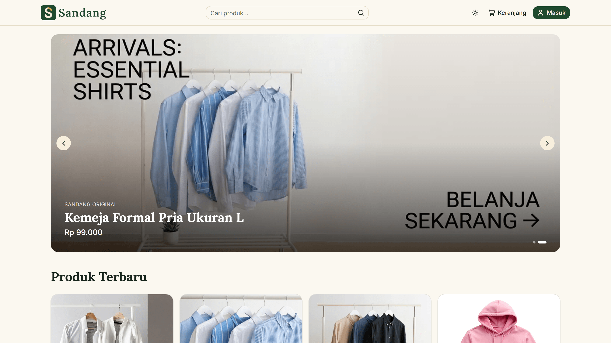
</p>

## Coba sekarang

1. Buka https://sandang.vercel.app
2. Masuk dengan akun demo, atau daftar dengan akun sendiri:

   | Email              | Kata sandi  |
   | ------------------ | ----------- |
   | `budi@example.com` | `demo12345` |
   | `siti@example.com` | `demo12345` |

3. Pilih produk, tambahkan ke keranjang, isi alamat, pilih metode pembayaran, lalu buat pesanan.
4. Bayar lewat jendela Midtrans. Ini **sandbox**, jadi tidak ada uang sungguhan. Ikuti simulator Midtrans untuk metode yang Anda pilih (lihat [dokumentasi Midtrans](https://docs.midtrans.com/)).
5. Status pesanan berubah menjadi **Lunas** dan stok produk berkurang.
6. Buka halaman produk yang sudah Anda beli untuk memberi ulasan.

**Panel admin** tidak dibuka untuk umum agar data demo tidak terhapus. Tampilannya ada di tangkapan layar di bawah, dan akun admin dapat diberikan atas permintaan.

## Fitur

**Toko**

- Katalog produk, carousel produk unggulan, dan halaman detail dengan galeri gambar
- Pencarian dengan filter kategori, rentang harga, rating, dan pengurutan (terbaru, harga, rating)
- Keranjang per pengguna yang tersimpan di database, dengan perhitungan ongkir dan PPN
- Checkout bertahap: alamat pengiriman, metode pembayaran, ringkasan pesanan
- Pembayaran Midtrans Snap (sandbox), dengan pembayaran ulang bila transaksi kedaluwarsa
- Riwayat pesanan dan halaman detail pesanan, profil pengguna
- Ulasan dan rating untuk pembeli yang sudah membayar, lengkap dengan sebaran bintang
- Mode terang dan gelap, tampilan responsif untuk HP

**Panel admin**

- Ringkasan: pendapatan bulanan, pesanan, dan penjualan per kategori (Recharts)
- Manajemen pesanan: filter, detail, dan tandai terkirim
- Manajemen produk: tambah, ubah, hapus, unggah gambar dengan UploadThing, pengaturan produk unggulan dan banner
- Akses dibatasi peran admin, dijaga di setiap halaman dan setiap server action

## Tangkapan layar

### Toko

| Pencarian dan filter                                                                     | Detail produk dan ulasan                                                                         |
| ---------------------------------------------------------------------------------------- | ------------------------------------------------------------------------------------------------ |
| 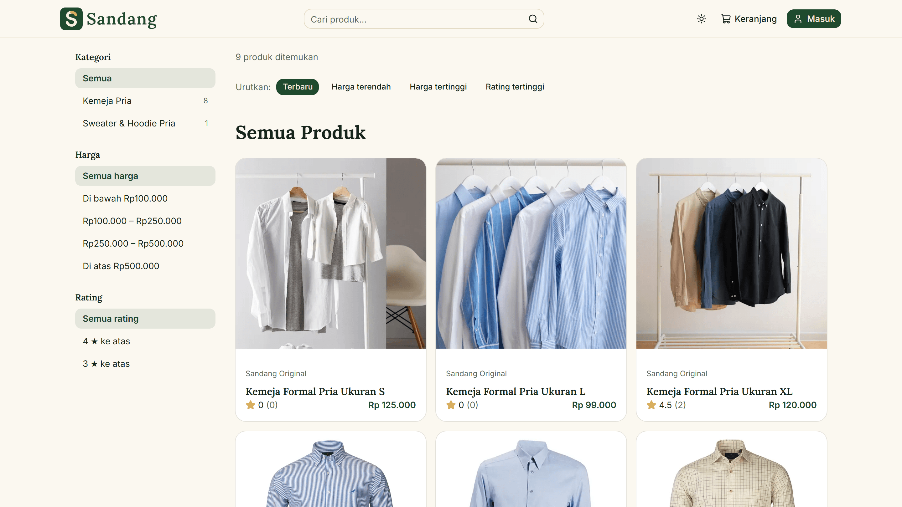 | 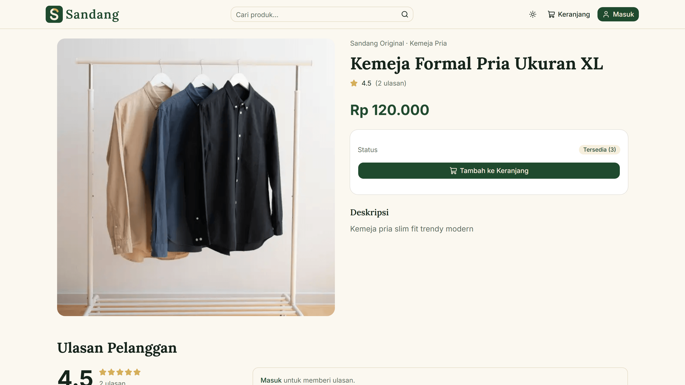 |

| Keranjang                                                                          | Ringkasan pesanan                                                                          |
| ---------------------------------------------------------------------------------- | ------------------------------------------------------------------------------------------ |
| 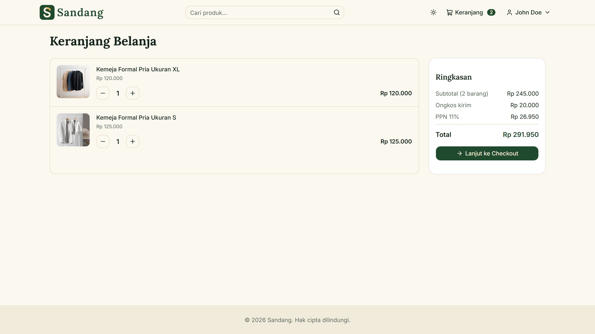 | 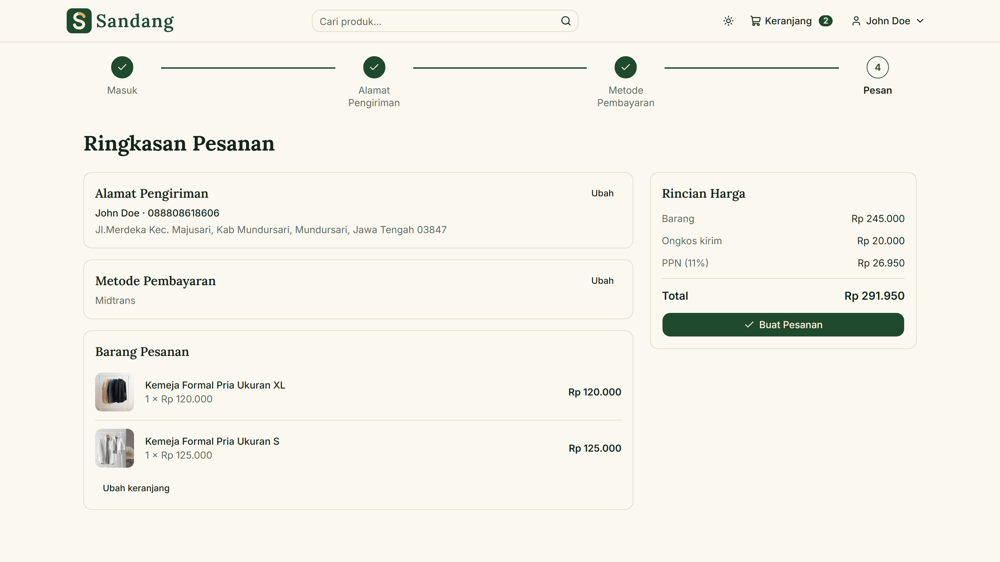 |

<p align="center">
  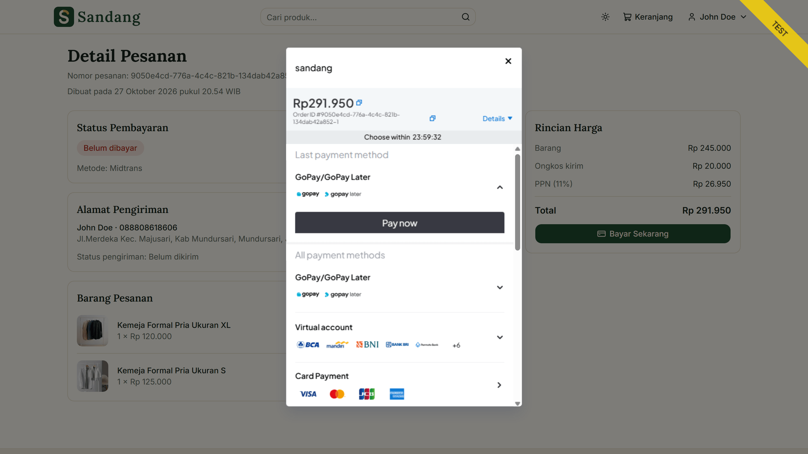
</p>

### Panel admin

<p align="center">
  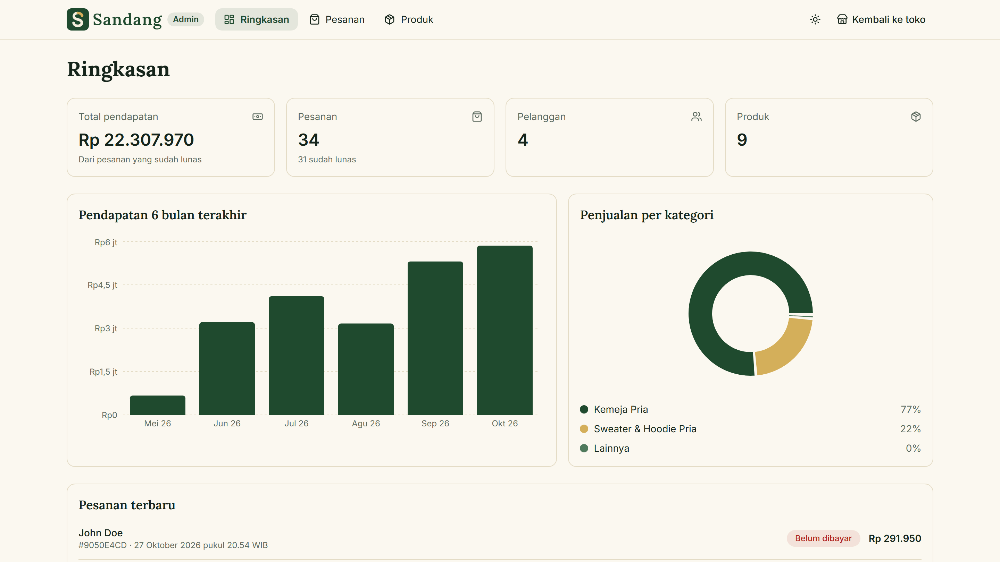
</p>

| Daftar pesanan                                                                            | Formulir produk                                                                                |
| ----------------------------------------------------------------------------------------- | ---------------------------------------------------------------------------------------------- |
| 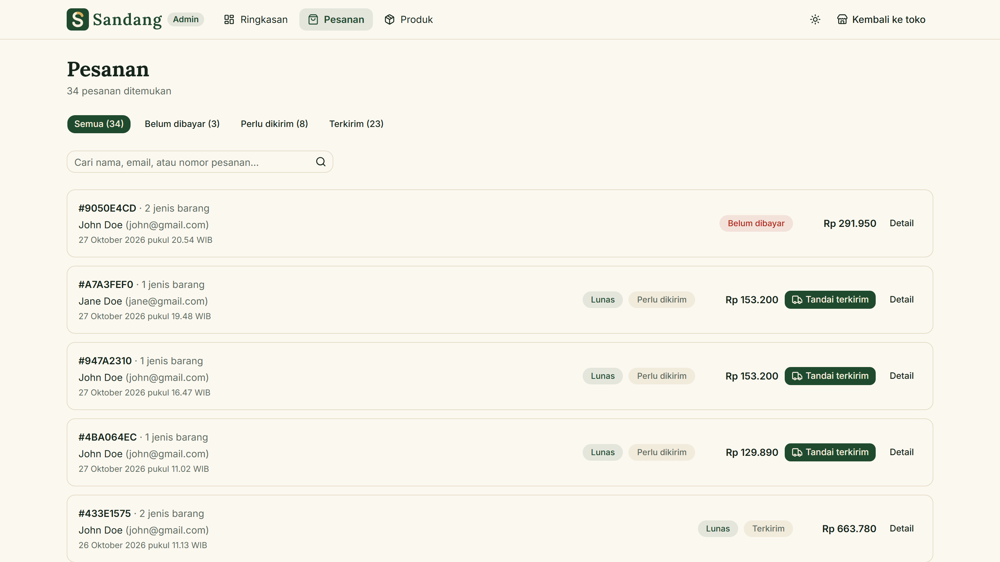 | 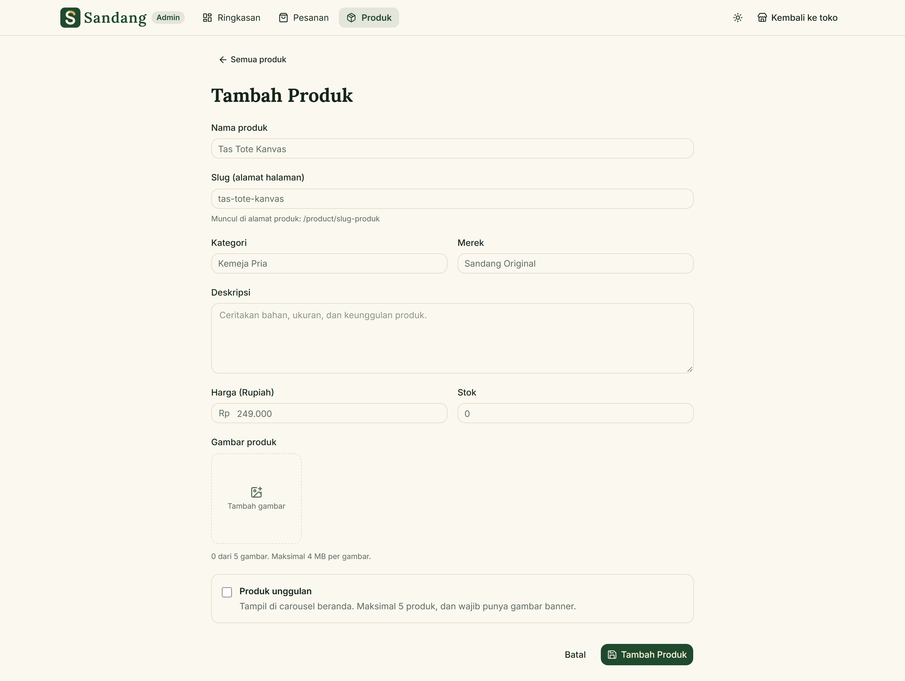 |

### Tampilan HP

<p align="center">
  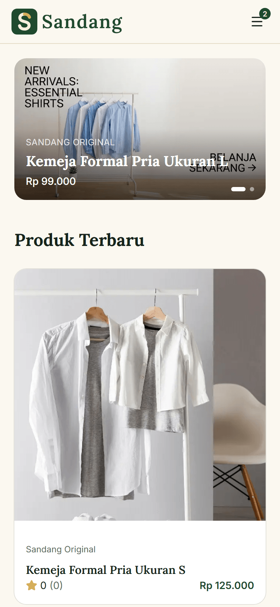
  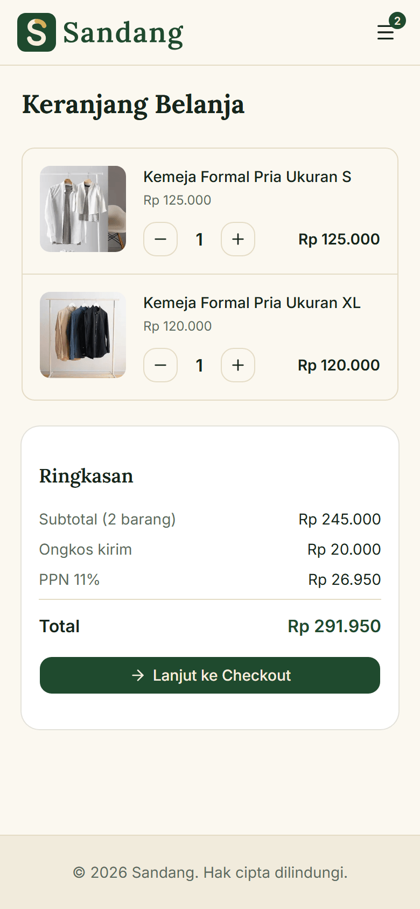
  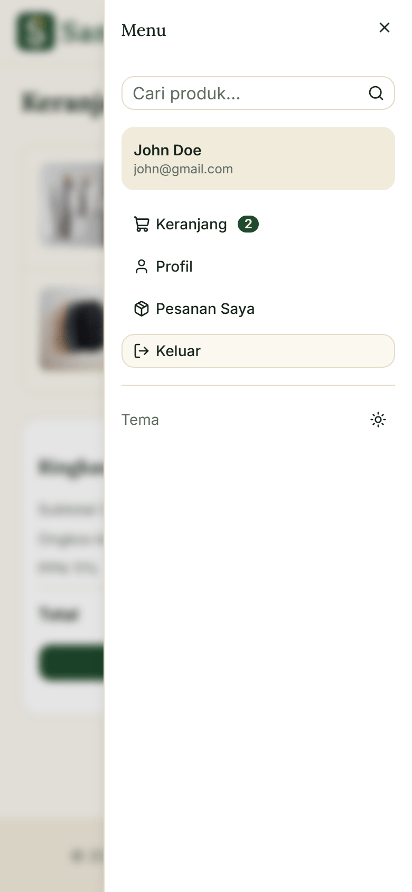
</p>

## Teknologi

| Bagian                | Yang dipakai                                                                     |
| --------------------- | -------------------------------------------------------------------------------- |
| Kerangka              | Next.js 15 (App Router, Server Components, Server Actions), React 19, TypeScript |
| Tampilan              | Tailwind CSS v4, shadcn/ui (varian Base UI), next-themes, lucide-react           |
| Database              | PostgreSQL di Neon, Prisma 7 dengan adapter Neon                                 |
| Autentikasi           | Better Auth (sesi di database, peran pengguna dan admin)                         |
| Formulir dan validasi | react-hook-form, Zod 4                                                           |
| Pembayaran            | Midtrans Snap (sandbox) dan webhook notifikasi                                   |
| Unggah gambar         | UploadThing                                                                      |
| Grafik                | Recharts                                                                         |
| Penyebaran            | Vercel                                                                           |

## Keputusan desain

Beberapa hal yang saya putuskan dengan sengaja:

- **Server adalah sumber kebenaran.** Harga, nama, dan gambar barang di keranjang selalu diambil dari database, bukan dari browser. `userId` selalu berasal dari sesi, bukan dari input, sehingga pesanan dan keranjang orang lain tidak bisa diakses (menghindari IDOR).
- **Webhook pembayaran yang aman.** Notifikasi Midtrans diverifikasi dengan tanda tangan SHA-512, nominalnya dicocokkan dengan pesanan, dan pemrosesannya idempoten (notifikasi ganda tidak mengurangi stok dua kali).
- **Pembayaran ulang yang benar.** Setiap upaya bayar memakai nomor transaksi sendiri (`<id-pesanan>-<upaya>`), karena Midtrans tidak mengizinkan nomor transaksi dipakai ulang setelah kedaluwarsa. Token yang masih aktif dipakai kembali, dan klik ganda diatasi dengan klaim atomik di database.
- **Pesanan menyimpan salinan data.** Nama, harga, dan gambar barang disalin ke `OrderItem`, jadi riwayat pesanan tetap utuh walau produknya kemudian diubah atau dihapus.
- **Keranjang membersihkan diri.** Barang yang produknya sudah dihapus admin otomatis dikeluarkan dari keranjang dengan pemberitahuan. Stok yang kurang hanya diberi pesan, keputusan tetap di tangan pembeli.
- **Rating selalu konsisten.** Rata-rata dan jumlah ulasan produk dihitung ulang dalam satu transaksi setiap ulasan dibuat, diubah, atau dihapus.
- **Zona waktu.** Semua waktu ditampilkan dalam WIB, tidak bergantung pada zona waktu server (Vercel berjalan di UTC).
- **Admin dijaga di dua lapis.** Layout dan halaman admin memeriksa peran, dan setiap server action admin memeriksanya lagi, karena server action adalah endpoint yang bisa dipanggil langsung.
- **Pembersihan file.** Gambar di UploadThing ikut dihapus ketika produk dihapus atau gambarnya diganti, kecuali masih dipakai oleh riwayat pesanan.

## Keterbatasan

Proyek ini untuk portofolio, bukan toko yang siap dipakai publik. Hal-hal yang belum ada, dan alasannya:

- **Belum ada verifikasi email dan reset kata sandi.** Karena itu email konfirmasi pesanan juga belum dibuat: tanpa verifikasi, email bisa terkirim ke orang yang tidak berkepentingan. Detail pesanan ditampilkan di dalam situs. Email akan menjadi satu paket dengan verifikasi dan reset kata sandi.
- **Pembayaran hanya Midtrans sandbox.** Tidak ada COD, dan tidak ada uang sungguhan yang berpindah.
- **Ulasan dibuka setelah pesanan lunas**, bukan setelah barang diterima. Ini keputusan sadar agar alur "beli lalu mengulas" bisa dicoba tanpa akses admin. Pada produksi, syaratnya sebaiknya diganti menjadi status terkirim atau diterima.
- **Stok dikurangi saat pembayaran lunas**, sementara pengecekan stok dilakukan saat pesanan dibuat. Pada lalu lintas tinggi, dua pembeli bisa lolos pengecekan untuk stok terakhir yang sama. Solusinya adalah reservasi stok, yang belum dibuat.
- **Data contoh.** Produk, pengguna, pesanan, dan ulasan di situs demo berasal dari skrip seed.
- **Gambar yatim di UploadThing.** Jika admin mengunggah gambar lalu menutup formulir tanpa menyimpan, file itu tetap ada di penyimpanan.
- **Belum ada pengujian otomatis.** Pengujian dilakukan manual untuk setiap alur.
- **Satu database untuk pengembangan dan demo.** Untuk produksi sungguhan, pengembangan sebaiknya memakai cabang database terpisah.

## Menjalankan di komputer sendiri

Prasyarat: Node.js 20 atau lebih baru, akun [Neon](https://neon.tech) (gratis), akun [Midtrans](https://midtrans.com) sandbox, dan akun [UploadThing](https://uploadthing.com).

```bash
# 1. Ambil kode dan pasang dependensi
git clone https://github.com/muhamadandy/sandang.git
cd sandang
npm install --legacy-peer-deps

# 2. Salin berkas contoh lingkungan, lalu isi nilainya
cp .env.example .env

# 3. Buat tabel di database
npx prisma generate
npx prisma db push

# 4. Isi data contoh (produk dan pengguna), pesanan demo, lalu ulasan demo
npx prisma db seed
npm run seed:orders
npm run seed:reviews

# 5. Jalankan
npm run dev
```

Buka http://localhost:3000. Pengguna contoh dibuat oleh seed: `admin@example.com` (admin, kata sandinya dari `SEED_ADMIN_PASSWORD` di `.env`), serta `budi@example.com` dan `siti@example.com` (kata sandi `demo12345`).

Catatan Midtrans: notifikasi pembayaran dikirim ke alamat yang diatur di dasbor sandbox (`/api/midtrans/notification`). Agar status "Lunas" terbarui saat pengembangan lokal, gunakan terowongan seperti ngrok, lalu isi _Payment Notification URL_ di dasbor Midtrans dengan alamat terowongannya.

### Skrip

| Perintah               | Fungsi                                                                                      |
| ---------------------- | ------------------------------------------------------------------------------------------- |
| `npm run dev`          | Menjalankan server pengembangan                                                             |
| `npm run build`        | `prisma generate` lalu build produksi                                                       |
| `npm run start`        | Menjalankan hasil build                                                                     |
| `npm run lint`         | Memeriksa kode dengan ESLint                                                                |
| `npx prisma db seed`   | Mengisi ulang produk dan pengguna contoh (menghapus data lama dengan akun contoh yang sama) |
| `npm run seed:orders`  | Membuat pesanan demo (`-- --clear` untuk menghapusnya)                                      |
| `npm run seed:reviews` | Membuat ulasan demo dan menghitung ulang rating (`-- --clear` untuk menghapusnya)           |

## Struktur proyek

```
app/
  (root)/        halaman toko: beranda, produk, keranjang, checkout, pesanan, profil
  (auth)/        masuk dan daftar
  admin/         panel admin: ringkasan, pesanan, produk
  api/           webhook Midtrans, route UploadThing, route Better Auth
components/
  ui/            komponen dasar shadcn/ui
  shared/        header, carousel, kartu produk, ulasan, dan lain-lain
  admin/         komponen khusus panel admin
lib/
  actions/       server action: keranjang, pesanan, produk, ulasan, admin
  validator.ts   skema Zod bersama untuk klien dan server
db/              skrip seed (produk, pengguna, pesanan demo, ulasan demo)
prisma/          skema database
```

Dibuat oleh **Muhamad Andy**.
